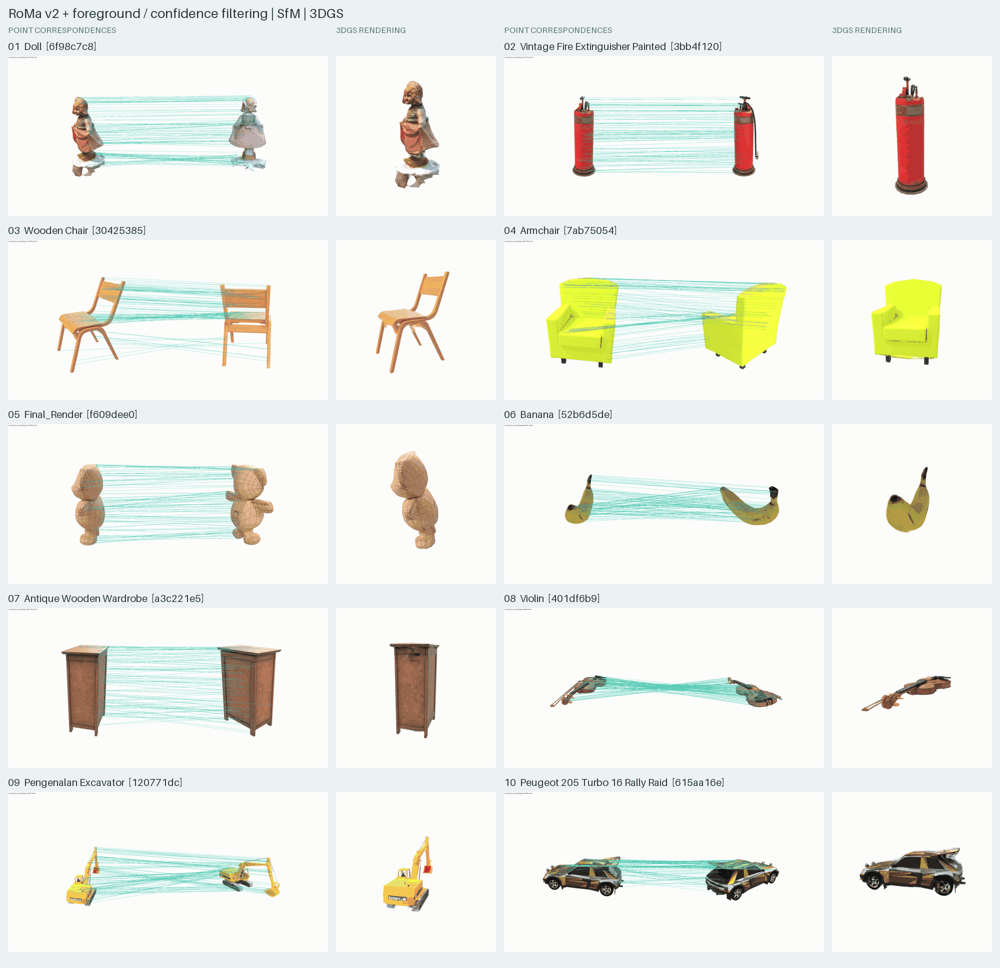

# Assignment 2 — 3D Reconstruction and Rendering

多视角图像 → RoMa v2匹配与前景、置信度过滤 → SfM → 3D Gaussian Splatting。

- **Pipeline documentation：** [docs/assignment2_report.md](docs/assignment2_report.md)，包含实现、分析及成员分工。
- **Prompts：** [prompts/user_requests.json](prompts/user_requests.json)。

## 推理示例

使用仓库自带的[Doll多视角图像](assets/doll/images)，从6张RGB图像生成匹配结果、相机与点云以及渲染GIF。先按[示例说明](assets/doll/README.md)准备依赖、RoMa源码和权重缓存，激活Python环境后，在**仓库根目录**运行以下命令。所有路径均相对于仓库根目录。

```bash
CUDA_VISIBLE_DEVICES=0 \
python scripts/infer.py \
  --images assets/doll/images \
  --roma-source third_party/romav2 \
  --torch-home weights/torch \
  --output outputs/doll \
  --steps 3000
```

渲染结果保存到 `outputs/doll/gaussian/centered.gif`。重复运行时请更换输出目录。

## 十物体展示

每行两个物体，共5行4列，依次为“匹配连线、渲染GIF、匹配连线、渲染GIF”。


