# ReconLab — 3D Reconstruction and Rendering

从多视角RGB恢复相机和稀疏几何，再优化3D Gaussian Splatting并渲染新视角。

**主流程：** 6张图 → RoMa v2 → 前景与overlap≥0.5过滤 → RANSAC / SfM → 3000步3DGS → 留出视角评估与居中环绕GIF。

[Pipeline documentation](docs/assignment2_report.md) · [实现与复现](experiments/roma100/README.md) · [提示词记录](prompts/user_requests.json) · [实验数据表](assets/tables) · [通用接口](src/reconlab/interfaces.py)

新增的[6／12／24／36视角对照](experiments/view_count/README.md)已完成，简要分析已补入报告第3.5节；对应代码与逐阶段指标已归档。下方10例GIF保留原6图、3k步展示结果。

组号、组员及贡献见报告中的待填写栏。报告按作业1清洗后的Objaverse数据作为输入来源的前提编写。GitHub仓库：[https://github.com/ciErraRuis/3dv_assignment2](https://github.com/ciErraRuis/3dv_assignment2)。

## Doll 多视角推理示例

仓库自带[6张Doll参考图及运行说明](assets/doll/README.md)。[推理入口](scripts/infer.py)默认使用这组asset，执行RoMa匹配、前景与分数过滤、SfM、3000步高斯优化及居中GIF生成；输入不含GT相机。正式报告第2.5节也提供了完整命令。

## 数据与评价

每物体源数据48张512×512图像；本轮固定6张训练、6张验证、6张测试。匹配器内部完整画面等比缩放至800/1280，保存实际输入和哈希。主路线估计相机参数，GT仅用于训练后的对齐与评估；最终方法说明和分析见报告，实验数据表仅保留正式报告引用的过滤与视角数量对照。GIF为已训练高斯渲染的72张512×512帧、24fps、总长3秒，编码可能合并相同帧。

以下10例由用户指定用于展示，不改变原10例对照或固定100例的统计分母。这里的分数为各物体6张留出图的平均值；展示集不用于估计总体成功率。

## 十物体匹配与渲染

| 编号 | 物体名称（源数据） | UID | 注册图 | Val FG-PSNR | Test FG-PSNR | 匹配图 | 3DGS GIF |
| --- | --- | --- | --- | --- | --- | --- | --- |
| 1 | Doll | 6f98c7c8ef0d456f8ce0a76e406c4696 | 6/6 | 15.97 | 15.89 | [查看](assets/showcase/6f98c7c8ef0d456f8ce0a76e406c4696/visuals/pair_000.png) | [播放](assets/showcase/6f98c7c8ef0d456f8ce0a76e406c4696/gaussian/centered.gif) |
| 2 | Vintage Fire Extinguisher Painted | 3bb4f120d0df42fcba3dc4f550aaa9e5 | 6/6 | 7.38 | 7.25 | [查看](assets/showcase/3bb4f120d0df42fcba3dc4f550aaa9e5/visuals/pair_000.png) | [播放](assets/showcase/3bb4f120d0df42fcba3dc4f550aaa9e5/gaussian/centered.gif) |
| 3 | Wooden Chair | 304253851afd493d958fc8e256c189df | 6/6 | 18.62 | 20.68 | [查看](assets/showcase/304253851afd493d958fc8e256c189df/visuals/pair_000.png) | [播放](assets/showcase/304253851afd493d958fc8e256c189df/gaussian/centered.gif) |
| 4 | Armchair | 7ab75054dea04187bca4da0917f501a3 | 6/6 | 24.27 | 23.43 | [查看](assets/showcase/7ab75054dea04187bca4da0917f501a3/visuals/pair_000.png) | [播放](assets/showcase/7ab75054dea04187bca4da0917f501a3/gaussian/centered.gif) |
| 5 | Final_Render | f609dee009554b3c9926504eb80f8029 | 6/6 | 8.03 | 7.89 | [查看](assets/showcase/f609dee009554b3c9926504eb80f8029/visuals/pair_000.png) | [播放](assets/showcase/f609dee009554b3c9926504eb80f8029/gaussian/centered.gif) |
| 6 | Banana | 52b6d5de9f8847dba363a93761874c9e | 6/6 | 6.83 | 7.46 | [查看](assets/showcase/52b6d5de9f8847dba363a93761874c9e/visuals/pair_000.png) | [播放](assets/showcase/52b6d5de9f8847dba363a93761874c9e/gaussian/centered.gif) |
| 7 | Antique Wooden Wardrobe | a3c221e5504d40a8ba019f8f1bf5ab0e | 6/6 | 15.22 | 15.86 | [查看](assets/showcase/a3c221e5504d40a8ba019f8f1bf5ab0e/visuals/pair_000.png) | [播放](assets/showcase/a3c221e5504d40a8ba019f8f1bf5ab0e/gaussian/centered.gif) |
| 8 | Violin | 401df6b99a4142eeb6bb1c02ef09c18d | 6/6 | 13.12 | 13.11 | [查看](assets/showcase/401df6b99a4142eeb6bb1c02ef09c18d/visuals/pair_000.png) | [播放](assets/showcase/401df6b99a4142eeb6bb1c02ef09c18d/gaussian/centered.gif) |
| 9 | Pengenalan Excavator | 120771dca01f44539491395b8daec730 | 6/6 | 15.72 | 16.21 | [查看](assets/showcase/120771dca01f44539491395b8daec730/visuals/pair_000.png) | [播放](assets/showcase/120771dca01f44539491395b8daec730/gaussian/centered.gif) |
| 10 | Peugeot 205 Turbo 16 Rally Raid | 615aa16e2f1946f48bc3aca64e97b618 | 6/6 | 15.30 | 17.37 | [查看](assets/showcase/615aa16e2f1946f48bc3aca64e97b618/visuals/pair_000.png) | [播放](assets/showcase/615aa16e2f1946f48bc3aca64e97b618/gaussian/centered.gif) |

### 展示 1：Doll

UID：`6f98c7c8ef0d456f8ce0a76e406c4696`。 [全部匹配文件](assets/showcase/6f98c7c8ef0d456f8ce0a76e406c4696/matches) · [全部连线图](assets/showcase/6f98c7c8ef0d456f8ce0a76e406c4696/visuals)。注册 6/6 张；测试前景 PSNR 15.89 dB。模型训练 3000 步；GIF 累计时长 3 秒，保留72张原始渲染PNG的哈希证据。

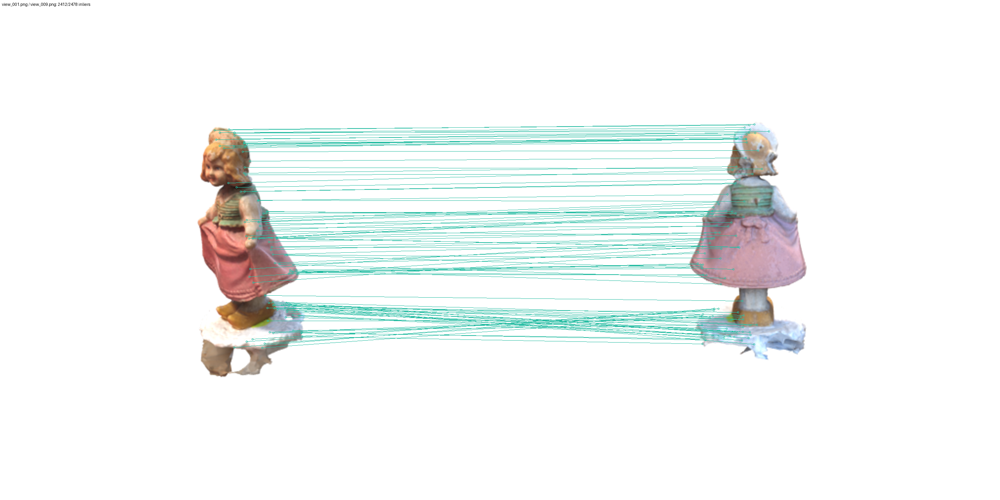

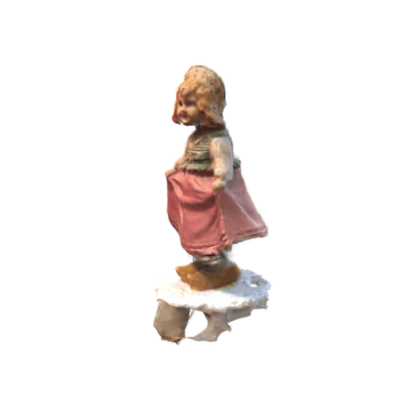

[实际 fine_1280 网络输入](assets/showcase/6f98c7c8ef0d456f8ce0a76e406c4696/model_inputs/fine_1280/view_001.png) · [前景掩码](assets/showcase/6f98c7c8ef0d456f8ce0a76e406c4696/foreground_masks/view_001.png) · [源模型许可：by](https://sketchfab.com/3d-models/6f98c7c8ef0d456f8ce0a76e406c4696)

### 展示 2：Vintage Fire Extinguisher Painted

UID：`3bb4f120d0df42fcba3dc4f550aaa9e5`。 [全部匹配文件](assets/showcase/3bb4f120d0df42fcba3dc4f550aaa9e5/matches) · [全部连线图](assets/showcase/3bb4f120d0df42fcba3dc4f550aaa9e5/visuals)。注册 6/6 张；测试前景 PSNR 7.25 dB。模型训练 3000 步；GIF 累计时长 3 秒，保留72张原始渲染PNG的哈希证据。

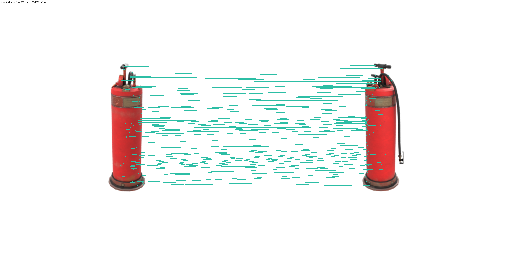

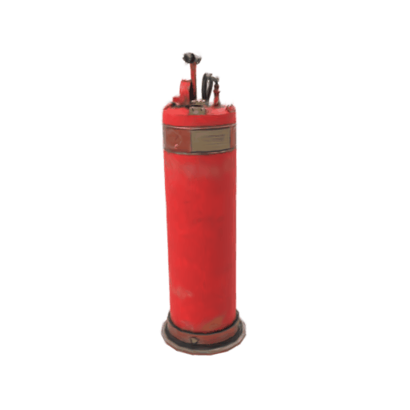

[实际 fine_1280 网络输入](assets/showcase/3bb4f120d0df42fcba3dc4f550aaa9e5/model_inputs/fine_1280/view_001.png) · [前景掩码](assets/showcase/3bb4f120d0df42fcba3dc4f550aaa9e5/foreground_masks/view_001.png) · [源模型许可：by](https://sketchfab.com/3d-models/3bb4f120d0df42fcba3dc4f550aaa9e5)

### 展示 3：Wooden Chair

UID：`304253851afd493d958fc8e256c189df`。 [全部匹配文件](assets/showcase/304253851afd493d958fc8e256c189df/matches) · [全部连线图](assets/showcase/304253851afd493d958fc8e256c189df/visuals)。注册 6/6 张；测试前景 PSNR 20.68 dB。模型训练 3000 步；GIF 累计时长 3 秒，保留72张原始渲染PNG的哈希证据。

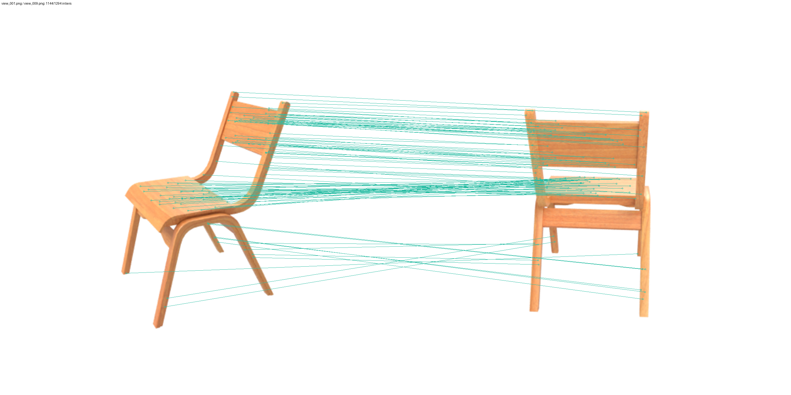

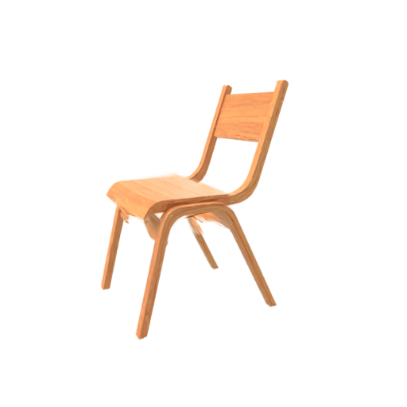

[实际 fine_1280 网络输入](assets/showcase/304253851afd493d958fc8e256c189df/model_inputs/fine_1280/view_001.png) · [前景掩码](assets/showcase/304253851afd493d958fc8e256c189df/foreground_masks/view_001.png) · [源模型许可：by](https://sketchfab.com/3d-models/304253851afd493d958fc8e256c189df)

### 展示 4：Armchair

UID：`7ab75054dea04187bca4da0917f501a3`。 [全部匹配文件](assets/showcase/7ab75054dea04187bca4da0917f501a3/matches) · [全部连线图](assets/showcase/7ab75054dea04187bca4da0917f501a3/visuals)。注册 6/6 张；测试前景 PSNR 23.43 dB。模型训练 3000 步；GIF 累计时长 3 秒，保留72张原始渲染PNG的哈希证据。

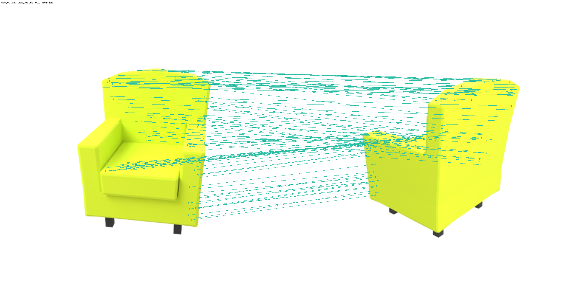

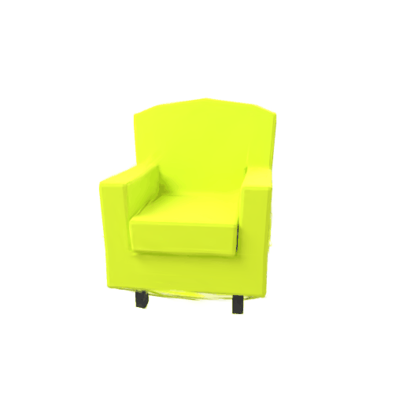

[实际 fine_1280 网络输入](assets/showcase/7ab75054dea04187bca4da0917f501a3/model_inputs/fine_1280/view_001.png) · [前景掩码](assets/showcase/7ab75054dea04187bca4da0917f501a3/foreground_masks/view_001.png) · [源模型许可：by](https://sketchfab.com/3d-models/7ab75054dea04187bca4da0917f501a3)

### 展示 5：Final_Render

UID：`f609dee009554b3c9926504eb80f8029`。 [全部匹配文件](assets/showcase/f609dee009554b3c9926504eb80f8029/matches) · [全部连线图](assets/showcase/f609dee009554b3c9926504eb80f8029/visuals)。注册 6/6 张；测试前景 PSNR 7.89 dB。模型训练 3000 步；GIF 累计时长 3 秒，保留72张原始渲染PNG的哈希证据。

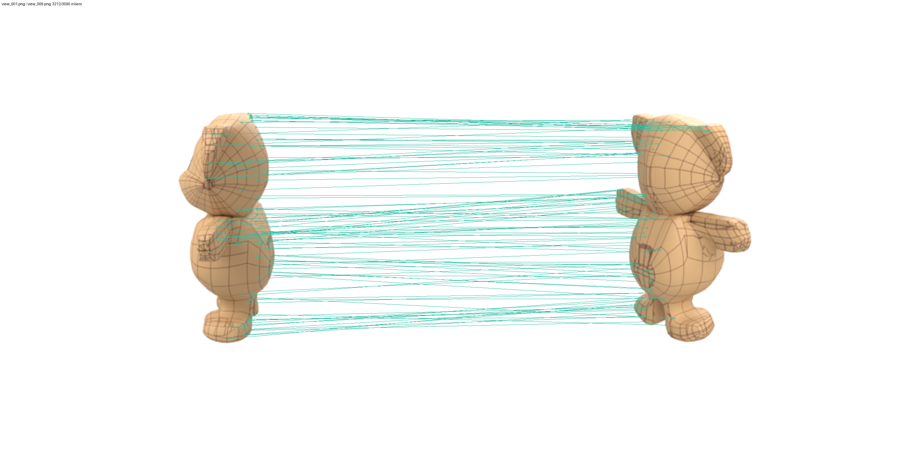

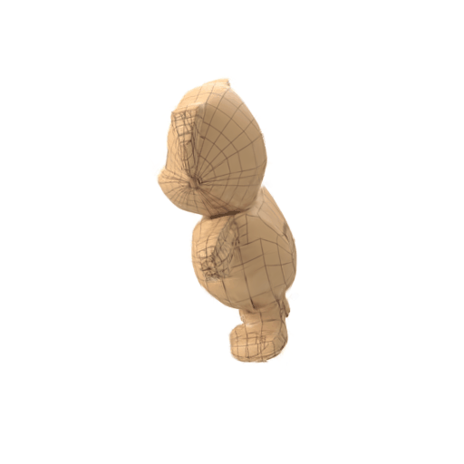

[实际 fine_1280 网络输入](assets/showcase/f609dee009554b3c9926504eb80f8029/model_inputs/fine_1280/view_001.png) · [前景掩码](assets/showcase/f609dee009554b3c9926504eb80f8029/foreground_masks/view_001.png) · [源模型许可：by](https://sketchfab.com/3d-models/f609dee009554b3c9926504eb80f8029)

### 展示 6：Banana

UID：`52b6d5de9f8847dba363a93761874c9e`。 [全部匹配文件](assets/showcase/52b6d5de9f8847dba363a93761874c9e/matches) · [全部连线图](assets/showcase/52b6d5de9f8847dba363a93761874c9e/visuals)。注册 6/6 张；测试前景 PSNR 7.46 dB。模型训练 3000 步；GIF 累计时长 3 秒，保留72张原始渲染PNG的哈希证据。

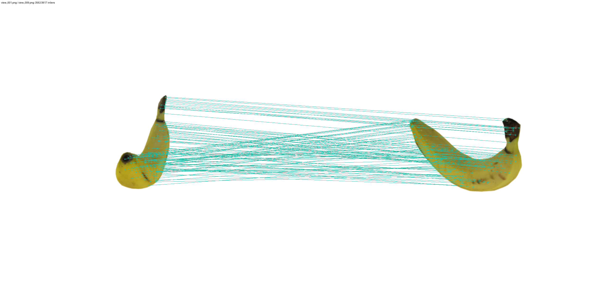

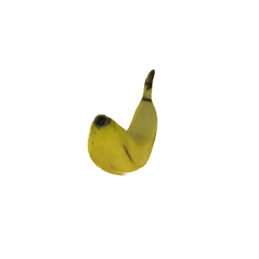

[实际 fine_1280 网络输入](assets/showcase/52b6d5de9f8847dba363a93761874c9e/model_inputs/fine_1280/view_001.png) · [前景掩码](assets/showcase/52b6d5de9f8847dba363a93761874c9e/foreground_masks/view_001.png) · [源模型许可：by](https://sketchfab.com/3d-models/52b6d5de9f8847dba363a93761874c9e)

### 展示 7：Antique Wooden Wardrobe

UID：`a3c221e5504d40a8ba019f8f1bf5ab0e`。 [全部匹配文件](assets/showcase/a3c221e5504d40a8ba019f8f1bf5ab0e/matches) · [全部连线图](assets/showcase/a3c221e5504d40a8ba019f8f1bf5ab0e/visuals)。注册 6/6 张；测试前景 PSNR 15.86 dB。模型训练 3000 步；GIF 累计时长 3 秒，保留72张原始渲染PNG的哈希证据。

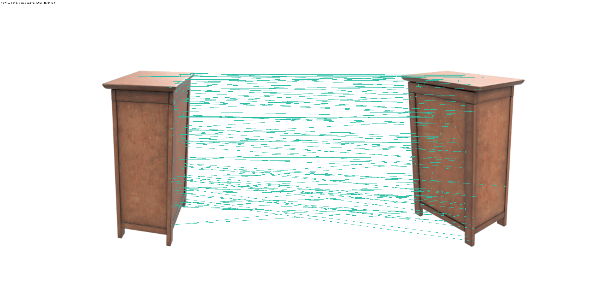

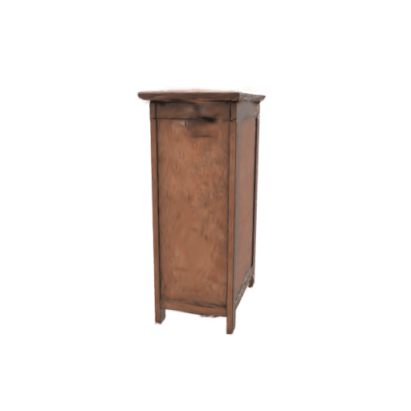

[实际 fine_1280 网络输入](assets/showcase/a3c221e5504d40a8ba019f8f1bf5ab0e/model_inputs/fine_1280/view_001.png) · [前景掩码](assets/showcase/a3c221e5504d40a8ba019f8f1bf5ab0e/foreground_masks/view_001.png) · [源模型许可：by](https://sketchfab.com/3d-models/a3c221e5504d40a8ba019f8f1bf5ab0e)

### 展示 8：Violin

UID：`401df6b99a4142eeb6bb1c02ef09c18d`。 [全部匹配文件](assets/showcase/401df6b99a4142eeb6bb1c02ef09c18d/matches) · [全部连线图](assets/showcase/401df6b99a4142eeb6bb1c02ef09c18d/visuals)。注册 6/6 张；测试前景 PSNR 13.11 dB。模型训练 3000 步；GIF 累计时长 3 秒，保留72张原始渲染PNG的哈希证据。

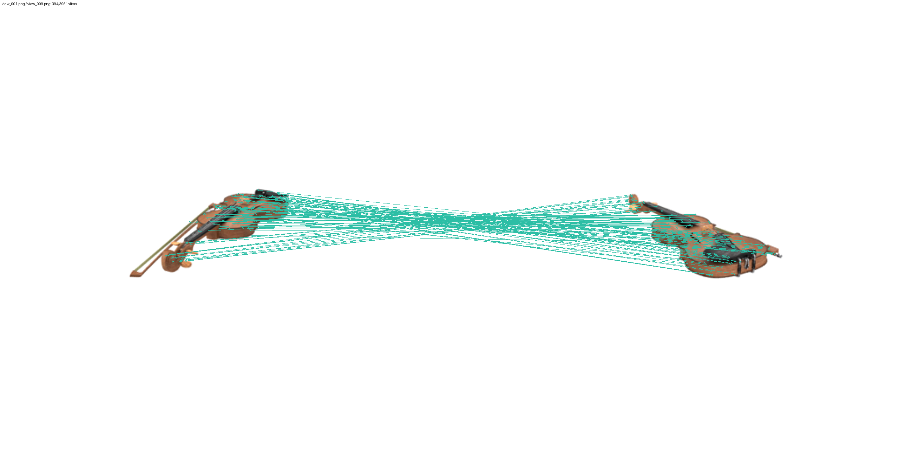

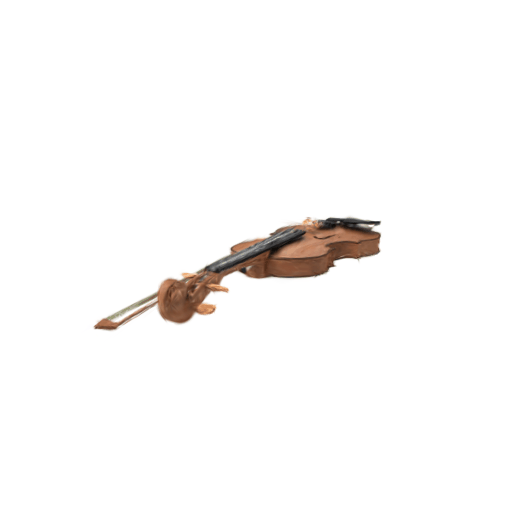

[实际 fine_1280 网络输入](assets/showcase/401df6b99a4142eeb6bb1c02ef09c18d/model_inputs/fine_1280/view_001.png) · [前景掩码](assets/showcase/401df6b99a4142eeb6bb1c02ef09c18d/foreground_masks/view_001.png) · [源模型许可：by](https://sketchfab.com/3d-models/401df6b99a4142eeb6bb1c02ef09c18d)

### 展示 9：Pengenalan Excavator

UID：`120771dca01f44539491395b8daec730`。 [全部匹配文件](assets/showcase/120771dca01f44539491395b8daec730/matches) · [全部连线图](assets/showcase/120771dca01f44539491395b8daec730/visuals)。注册 6/6 张；测试前景 PSNR 16.21 dB。模型训练 3000 步；GIF 累计时长 3 秒，保留72张原始渲染PNG的哈希证据。

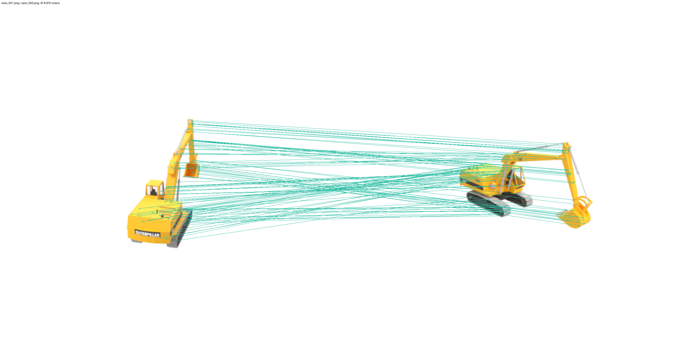

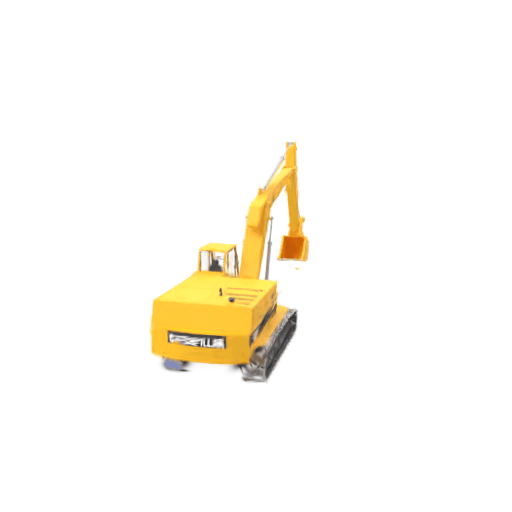

[实际 fine_1280 网络输入](assets/showcase/120771dca01f44539491395b8daec730/model_inputs/fine_1280/view_001.png) · [前景掩码](assets/showcase/120771dca01f44539491395b8daec730/foreground_masks/view_001.png) · [源模型许可：by](https://sketchfab.com/3d-models/120771dca01f44539491395b8daec730)

### 展示 10：Peugeot 205 Turbo 16 Rally Raid

UID：`615aa16e2f1946f48bc3aca64e97b618`。 [全部匹配文件](assets/showcase/615aa16e2f1946f48bc3aca64e97b618/matches) · [全部连线图](assets/showcase/615aa16e2f1946f48bc3aca64e97b618/visuals)。注册 6/6 张；测试前景 PSNR 17.37 dB。模型训练 3000 步；GIF 累计时长 3 秒，保留72张原始渲染PNG的哈希证据。

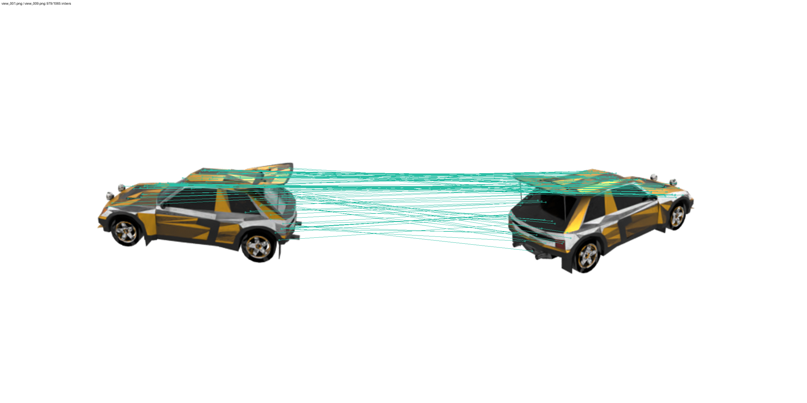

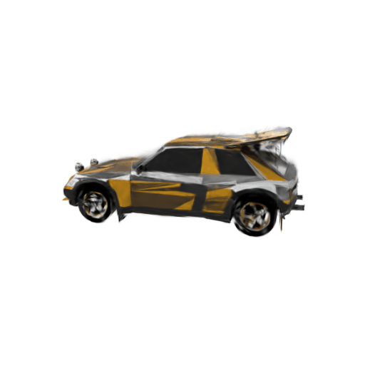

[实际 fine_1280 网络输入](assets/showcase/615aa16e2f1946f48bc3aca64e97b618/model_inputs/fine_1280/view_001.png) · [前景掩码](assets/showcase/615aa16e2f1946f48bc3aca64e97b618/foreground_masks/view_001.png) · [源模型许可：by](https://sketchfab.com/3d-models/615aa16e2f1946f48bc3aca64e97b618)

## 提交目录

- `assets/doll`：命令示例使用的6张多视角输入及哈希、来源许可。
- `assets/showcase`、`assets/figures`、`assets/tables`：10例全部匹配结果、连线图、居中GIF、[10例总览GIF](assets/showcase_overview.gif)、输入溯源及正式分析所需统计表。
- `configs/roma100.json`：最终RoMa＋过滤＋SfM＋3DGS的实际参数与来源清单。
- `configs/view_count.json`：报告中的视角数量对照参数。
- `experiments/roma100`、`experiments/view_count`：主实验及视角对照实现，共用`src`中的算法模块。

## 原始证据与代码

各物体目录包含全部15对匹配的NPZ、4对代表性连线图、前景mask、过滤统计、SfM相机和点云、指标、训练记录及GIF。原始输入RGB、实际网络输入示例及完整预处理哈希随结果保留；完整未过滤对应与其余网络输入PNG保存在原实验存储，不重复提交。`matches/*.npz`保存坐标、分数和几何内点；`geometry.npz`保存恢复几何。72张原始环绕PNG的哈希另存，完整PNG及高斯checkpoint按溯源记录保存在实验存储，不提交大权重。

- [当前实验源码快照与环境说明](experiments/roma100/README.md)
- [报告原始统计表](assets/tables)、[来源与哈希](assets/artifact_manifest.json)
- [源物体清单与许可](configs/roma100.json)：每个展示卡片亦链接到原模型来源。

提示词文件收录目前可追溯的任务相关用户请求；不是所有历史模型调用的完整导出，也不包含系统指令或凭据。正式提交前仍需核对提示词覆盖范围。
