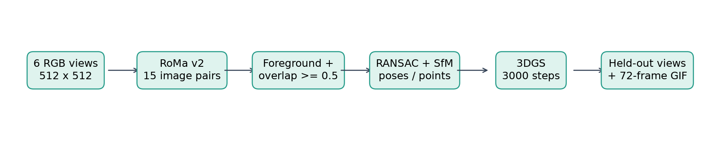

# Assignment 2：多视角图像三维重建与高斯渲染

**组号：** 第三组  
**GitHub 仓库：** [https://github.com/ciErraRuis/3dv_assignment2](https://github.com/ciErraRuis/3dv_assignment2)

| 学号 | 组员姓名 | 分工安排（建议，提交前由组员核对） |
| --- | --- | --- |
| 260010098 | Rui Yan | 多视角数据整理；RoMa v2匹配与前景、置信度过滤；SfM相机与稀疏点云恢复。 |
| 260010099 | MingDa Jia | 管线架构与模块接口；3D Gaussian Splatting优化与渲染；推理入口及环绕GIF生成。 |
| 260010088 | Haoran Xu | 视角数量与优化步数对照实验；重建质量分析与结果汇总；报告撰写及GitHub提交材料整理。 |

## 摘要

本项目使用作业1清洗后的数据构建从多视角图像到三维重建和新视角渲染的完整管线。最终采用 **RoMa v2稠密匹配、前景与置信度过滤、SfM相机及点云恢复、3D Gaussian Splatting优化**，并为10个物体生成环绕展示GIF。本文重点分析各环节如何影响最终质量：背景匹配如何干扰几何估计，过滤强度如何影响视图连通性，相机误差如何传递到高斯重建，以及稀疏视角、物体结构和评价方式带来的影响。

主要发现是：匹配数量增加并不一定改善重建，可靠且分布合理的跨视图对应更加关键；前景与置信度过滤能够改善部分对象的渲染，但也可能减少可用观测；高斯优化依赖前端提供的相机与几何，训练损失下降不能保证新视角正确。完整代码、提示词记录、10个物体的匹配结果和GIF集中放在GitHub仓库及README中。

## 1. 数据与方法选择

### 1.1 数据及输入设置

本文将数据来源设定为**作业1清洗后的Objaverse数据集**。对清洗后保留的物体，使用Blender生成多视角RGB图像：每物体48张512×512图像，白色背景，模型等比例归一化，保留完整画面。相机分布在20°和40°两个俯仰环，每环24个方位；图像划分为36张训练候选、6张验证和6张测试。

最终管线固定使用6张训练图，即 `view_001/009/017/025/033/041.png`。它们覆盖两个高度，每个高度包含3个方位，方位间隔为120°。另外6张验证图用于质量检查，6张测试图用于留出视角评价；二者均不参与匹配、SfM和高斯训练。用于提交展示的10个物体及对应GIF见仓库README。

源图保持512×512。RoMa v2的实际网络输入为800×800粗尺度和1280×1280精尺度，采用完整画面等比缩放；预测坐标随后映射回原图。保存实际网络输入的显示图、原图与张量哈希，保证匹配可视化可以追溯到实际推理输入。

### 1.2 尝试的方法与最终选择

前期尝试了SIFT、SURF等传统特征方法，SuperPoint＋LightGlue等学习式稀疏匹配，以及LoMa、RoMa v2、MASt3R和GLUEMAP等匹配或重建方案；渲染端也尝试了3DGS、3DGS-MCMC和2DGS等实现。综合本数据上的匹配覆盖、相机恢复情况与渲染观感，最终采用 **RoMa v2＋前景和置信度过滤＋SfM＋3DGS**。下文集中介绍这一管线及影响结果的因素，不展开各候选方法的逐项实验比较。

## 2. 完整Pipeline及实现



### 2.1 对应点预测与过滤

6张训练图组成15个无序图像对。RoMa v2使用预训练的特征提取、跨图粗匹配和局部细化网络，直接预测稠密对应坐标及overlap分数，无需先检测传统关键点。每对图像按官方采样流程取5000个候选对应，再执行本项目的筛选。[1]

过滤包含两个条件。首先，在原图上将RGB三个通道均不小于250的像素视为近白候选，用4连通分析找出与图像边界相连的背景，将其排除；保留区域向外膨胀1像素以保护边缘。其次，只保留**两个端点均位于前景且overlap≥0.5**的对应。这里的overlap表示模型预测的共同可见程度，不是经过校准的匹配正确概率。

过滤后的对应实际进入SfM，原始RGB及高斯训练图像损失保持不变。代码同时保存原始坐标、分数、各条件的通过标记及最终保留标记；对应不足时不回填低分点。

### 2.2 几何验证与相机恢复

过滤后的对应先通过USAC_MAGSAC基础矩阵验证，原图坐标下的阈值为1.5像素。随后将图像对中的观测组织成多视图轨迹，通过pycolmap执行增量相机注册、三角化和bundle adjustment，得到相机参数及稀疏点云。[2]

相机使用共享的 `SIMPLE_PINHOLE` 模型，初始焦距为图像最大边长的1.2倍，主点固定在图像中心；SfM优化焦距与外参。主流程不向匹配器或SfM提供GT相机、深度或原网格。若产生多个重建分量，选择注册图像最多的分量；至少需要3张注册图像和20个可用三维点才能进入后续高斯优化。

### 2.3 高斯重建与渲染

使用SfM点云初始化高斯中心，点的颜色初始化球谐颜色，近邻距离初始化尺度，最多使用20000个初始点。每个高斯包含位置、旋转、尺度、不透明度和颜色参数，通过可微光栅化生成图像并与训练图比较。[3][4]

实现基于gsplat，固定SfM估计的相机，优化高斯参数。采用3000步训练、随机种子42、二阶球谐，以及 `0.8 × L1 + 0.2 × (1 − SSIM)` 损失。200—2500步之间每100步执行增密检查，使表示逐步适应图像细节。当前最终管线使用这一3DGS实现。

定量评价时，仅用已注册训练相机拟合Sim(3)对齐，再将留出相机映射到重建坐标系中渲染；GT信息用于训练结束后的评价。展示时另设居中环绕轨迹：从训练高斯估计中心和范围，以相机上方向确定直立方向，并始终朝向物体中心。每个GIF由72张512×512渲染帧组成，24fps、总长3秒。GIF来自优化后的高斯模型；定量指标使用原始渲染图，不使用GIF压缩图。

### 2.4 工程组织

实现按职责封装为类：`RomaV2Matcher`负责对应预测，`BorderWhiteForeground`与`FilteredMatcher`负责过滤，`PairwiseReconstruction`和`TrackGraph`负责几何验证与轨迹组织，`IncrementalMapper`负责SfM，`GaussianBenchmark`负责高斯优化和评价，`CenteredOrbit`负责展示轨迹。各模块通过图像列表、对应点和统一的 `Geometry` 数据结构衔接，便于独立替换匹配器或渲染后端。

使用RoMa v2 `romav2.0.1.pt`，运行环境包括PyTorch2.7.1+cu126、pycolmap3.13.0和gsplat1.4.0。完整权重哈希、源码版本、配置、输入划分及复现说明保存在仓库中。

### 2.5 推理方法：从参考图到新视角图像

本管线包含**预训练匹配网络的推理、逐物体的三维表示优化、已训练高斯的新视角渲染**三个阶段。RoMa v2使用固定预训练权重预测对应关系，本实验不微调匹配网络；每个新物体仍需单独恢复相机、初始化点云并优化高斯，不能直接用另一个物体的高斯checkpoint生成该物体。

对于新物体，先将选定训练图送入`RomaV2Matcher`，执行第2.1节的完整图像缩放、对应采样与mask／分数过滤；再由`PairwiseReconstruction`估计相机及点云，最后调用`GaussianBenchmark.fit`优化并保存该物体的`gaussians.pt`。主展示使用3000步模型；视角数量补充实验使用15000步，并保留每3000步的checkpoint。模型选择只使用验证集，图数对照的主比较固定使用15000步终点。

**已有模型的渲染推理**只需要该物体的高斯参数、目标相机内参和外参。读取checkpoint中的`state`、`center`与`scene_scale`，将参数移到GPU；渲染时使用`torch.inference_mode()`，不计算损失、不反向传播，也不更新高斯。`state`保存中心、四元数、对数尺度、不透明度logit与球谐系数，送入渲染器前分别对尺度取指数、对不透明度取sigmoid，并拼接`sh0`与`shN`。

目标相机必须与高斯处于相同坐标系。若相机来自原SfM坐标，先按checkpoint记录将相机中心转换为`(camera_center − center) / scene_scale`，旋转保持不变；若轨迹已经使用训练时的归一化坐标，则不重复归一化。外参采用OpenCV约定的camera-to-world矩阵`c2w`（相机向前为+Z，向下为+Y），渲染器接收其逆矩阵。下面是实际gsplat调用的核心形式；其中`params`、`c2w`和`K`已完成加载、坐标转换并成为CUDA张量，`c2w`与`K`分别为4×4和3×3矩阵：

```python
import torch
from gsplat import rasterization

with torch.inference_mode():
    rgb, alpha, _ = rasterization(
        means=params["means"],
        quats=params["quats"],
        scales=params["scales"].exp(),
        opacities=params["opacities"].sigmoid(),
        colors=torch.cat([params["sh0"], params["shN"]], dim=1),
        viewmats=torch.linalg.inv(c2w)[None],
        Ks=K[None],
        width=512, height=512, sh_degree=2,
        backgrounds=torch.ones((1, 3), device=c2w.device),
        packed=False, near_plane=0.01, far_plane=100,
    )
    image = rgb[0].clamp(0, 1)
```

光栅化将三维高斯投影到目标图像，根据观察方向计算球谐颜色，并按深度与不透明度合成像素。展示时，由`CenteredOrbit`生成始终看向物体中心的72个相机位置，依次渲染512×512图像，保存PNG后按24fps编码成3秒GIF；白底、二阶球谐以及近远裁剪面设置与训练后评价保持一致。对应实现是[渲染类`CenteredGaussianRenderer`与轨迹类`CenteredOrbit`](../src/reconlab/benchmark/presentation.py)。

普通展示轨迹可由估计的相机和已训练高斯构造，不需要GT相机。留出视角的定量评价则由`GaussianBenchmark.evaluate`使用训练相机中心拟合Sim(3)，再将GT留出相机映射到高斯坐标中。报告中的视角数量实验也执行了这一坐标转换，让不同图数组及checkpoint使用同一实际展示轨迹和内参；该对齐发生在训练结束后，不反馈给匹配、SfM或高斯优化。指标由留出视角的渲染结果计算，GIF只用于展示。

**Doll示例与运行命令。** 仓库提供[实际使用的6张Doll多视角RGB](../assets/doll/README.md)，相机参数由推理入口自行恢复。按[Doll示例说明](../assets/doll/README.md)准备依赖、源码和权重缓存，激活兼容的GPU环境后，在**仓库根目录**执行以下命令。所有路径均为相对路径，输出使用一个全新目录：

```bash
CUDA_VISIBLE_DEVICES=0 \
python scripts/infer.py \
  --images assets/doll/images \
  --roma-source third_party/romav2 \
  --torch-home weights/torch \
  --output outputs/doll \
  --steps 3000
```

生成的匹配连线位于输出目录的`visuals`，估计几何为`geometry.npz`，最终动画为`gaussian/centered.gif`。追加`--check-inputs`可仅在CPU上检查图片尺寸与哈希，不启动重建。源码与缓存需提前放入命令指定的目录，也可按实际位置修改相对路径；新命令包装的CPU核验与既有算法的GPU实验记录分开，不将未执行的新运行记为完成。

## 3. Analysis and Findings

### 3.1 匹配质量应由几何一致性衡量

匹配图上的连线表示两张图中的对应位置，但连线多、分布密集或局部看起来合理，并不意味着能够恢复正确的三维结构。SfM要求对应关系跨多张图保持一致：同一物体点应形成可连接的轨迹，不同位置的点还需提供足够的几何约束。

白色背景、重复纹理与近似对称结构都可能产生有规律却错误的对应。即使部分对应通过双视图几何验证，也可能无法组成正确的多视图几何。因此，我们保留匹配可视化，同时检查注册相机数、点云分布和留出视角渲染。**匹配图用于定位问题，相机与渲染结果用于判断这些对应是否真正支持重建。**

这也解释了为什么“某个匹配器的连线看起来不错，高斯结果却很差”：连线图只展示局部二维关系，后续还存在轨迹组织、内参估计、相机注册和三角化等环节。不能将这一现象直接归因于高斯渲染器。

### 3.2 背景过滤改善约束的有效性

当前物体图像有较大面积的白色背景。背景中的匹配可能占用候选点数量，并对相机估计提供错误约束。原始匹配审计中，约63.4%的RANSAC内点至少有一端落在近白像素上。近白像素也可能属于白色表面或高光，因此该比例是排查线索，不能直接解释为背景错误率。

在固定10例的前景过滤检查中，平均验证前景PSNR从13.12提高到13.90 dB，约增加0.78 dB。输入图像和高斯训练设置保持一致，变化发生在进入SfM的对应关系上。这支持一个实际结论：**在本白底设置中，减少与物体无关的对应，比单纯保留更多点更有帮助。**

边界连通分析优于直接删除所有近白像素的一点，是它能够保留一部分与边界背景不连通的白色区域；1像素膨胀也能缓解边缘误删。但白色表面若与背景连通，仍可能被删除。当前mask是针对白底数据的启发式方法，不能直接推断其在复杂背景或透明物体上同样有效。

### 3.3 置信度过滤存在质量与覆盖率的权衡

overlap阈值进一步剔除低分候选，但阈值越高，可用于连接视图的观测也越少。在三种过滤设置均完成的相同9个物体上，原始匹配、仅前景过滤、前景加分数过滤的平均验证前景PSNR分别为13.79、14.53和15.01 dB。增加分数过滤后，平均进一步提升约0.48 dB，但逐物体并非全部改善。

与此同时，原10例检查中的自行车在双重过滤后只注册了2/6张相机，未能进入有效高斯重建。因此，不能只根据成功样本的平均分数判断阈值越严格越好：**过滤既可能减少错误匹配，也可能切断原本勉强连通的视图关系。** 这个案例体现了覆盖率的代价；仅凭现有结果，还不能确定是细杆mask误删、低分有效点被删除，还是二者共同造成。

最终使用0.5阈值，是在本数据及视觉检查下确定的工程选择，不代表已证明它是所有物体的最佳阈值。后续可在独立验证集上研究阈值与最小轨迹覆盖的关系，但不能通过逐个查看测试结果来为每个物体调参。

### 3.4 相机误差会传递到高斯表示

相机决定三维点如何投影到二维像素。当前3DGS固定SfM相机，因此若位姿或焦距存在偏差，即使高斯优化继续降低训练损失，也可能通过改变位置、尺度或不透明度去补偿错误投影。这会带来训练视角附近看似合理、换到新视角后发生错位或缺失的风险。

在未过滤的RoMa诊断结果中，瓶子案例的相机旋转中位误差约为54.29°，说明“所有图像都已注册”并不足以判断位姿正确。对这类结果，增加高斯训练步数不能保证解决上游相机问题。应先检查匹配、相机和点云，再判断优化预算是否不足。

因此，最终质量应沿着**对应关系→相机→点云→高斯→留出视角**逐级检查。相机注册数量衡量覆盖，位姿误差反映几何可靠性，而渲染质量反映这些误差对最终输出的共同影响，三者不能互相替代。

### 3.5 稀疏视角同时限制连通性与表面覆盖

当前6张输入实际只有3个不同方位，每个方位有两个高度。两个高度可以增加部分表面的观察机会，但不能替代更多方位；120°的方位间隔也意味着部分图像对的可见表面重叠较少。未被充分观测的背面、凹陷和遮挡区域缺少直接监督，高斯只能依据有限证据拟合。

视角选择因此存在两种需求：相邻视角提供重叠，便于建立对应；分散视角增加物体覆盖，便于重建更多表面。只集中拍摄一个方向可能容易恢复局部几何，却缺少背面；只选少量大间隔视图，则可能覆盖广但难以连成一个重建分量。

为检验视角数量的影响，我们在固定10个物体上补充6、12、24和36张参考图的对照，各组独立恢复相机和点云，固定验证/测试划分，并统一训练15000步。均匀覆盖四组完成重建与渲染的数量依次为10/10、10/10、10/10、10/10；在四组均成功的10个物体上，验证前景PSNR依次为14.02、15.83、17.13、16.14 dB。其中6个物体在增加图数的某一步出现下降，说明更多观测并不保证单调改善。与相邻取样按同物体、同图数配对比较，均匀覆盖在0/3种图数下取得更高均值（各组配对数10、10、10），提示取样覆盖需要与图数一起考虑。例如扶手椅从6张增至12张时，平均相机旋转误差由0.75°增至16.66°，同时渲染得分下降，表明新增视图仍需形成可靠的多视图几何。这些结果反映固定总步数下的表现；图数越多，每张图平均接受的优化次数越少，不能直接解释为各组充分收敛后的上限。

### 3.6 物体结构与优化预算共同影响细节

细杆、轮辐和薄片在图像中只占少量像素，容易受到mask边界、缩放和对应误差影响；大面积弱纹理区域缺少稳定的定位线索；重复或近似对称的表面则可能支持多种相似对应。这些因素说明，统一参数下不同物体的重建难度并不相同。具体失败原因仍需结合对应审计和几何结果判断，不能仅凭物体类别断言。

3000步优化提供了统一且较快的重建预算，但不是收敛证明。点云覆盖不足时，增密只能在现有监督下调整表示，无法可靠恢复完全没有观察证据的表面；相机存在系统误差时，延长训练也未必改善新视角。因此，改善结果的顺序应是先确认输入覆盖和几何可靠，再考虑增加优化步数或更换后端。

### 3.7 评价应聚焦前景，并区分展示与测量

白底图像中，预测正确的大面积背景可能掩盖物体上的错误。因此采用前景PSNR辅助全图PSNR和SSIM，并在固定留出视角评价。前景区域由参考图中任一RGB通道小于0.96的像素定义；先计算每视图分数，再在物体内平均，最后跨物体平均。该评价区域与用于匹配过滤的mask不同。

即便如此，前景PSNR仍反映投影图像误差，不能直接当作三维表面精度。相机对齐、遮挡和纹理都可能影响其数值，评价时需要结合几何与多视角观察。成功样本的均值也必须与完成数量一起解释，不能隐藏失败对象。

居中直立的环绕GIF让整体形状和连续性更容易观察，但它只调整展示相机，不会修复重建。更顺畅的GIF不能被当作定量质量提升。README中的10个物体用于展示实际结果；它们经过展示选择，不能代表全部对象的平均成功率。

## 4. 总结

本项目完成了由多视角图像出发，经RoMa v2对应预测、前景与置信度筛选、SfM几何恢复，再到3DGS优化和新视角渲染的完整实现。分析表明，最终结果依赖各环节之间的传递关系：可靠匹配需要形成跨视图一致的几何，过滤需要兼顾错误抑制与视图连通，相机误差会限制高斯拟合，而输入覆盖决定可恢复的信息范围。

当前方案在白底、稀疏视角条件下取得了可展示的结果，同时保留过滤后无法重建等失败证据。后续改进应优先围绕视角覆盖、前景识别和相机可靠性展开，再评估更长优化预算的收益。10个物体的点匹配结果、重建GIF、完整代码及提示词记录见GitHub仓库README；组号与成员贡献在报告首页填写。

## 参考文献

[1] Edstedt et al. *RoMa v2: Harder Better Faster Denser Feature Matching*. [论文](https://arxiv.org/abs/2511.15706)，[官方代码](https://github.com/Parskatt/RoMaV2)。

[2] Schönberger and Frahm. *Structure-from-Motion Revisited*. CVPR 2016。[COLMAP官方说明](https://colmap.github.io/tutorial.html)。

[3] Kerbl et al. *3D Gaussian Splatting for Real-Time Radiance Field Rendering*. SIGGRAPH 2023。[论文与代码](https://repo-sam.inria.fr/fungraph/3d-gaussian-splatting/)。

[4] *gsplat: An Open-Source Library for Gaussian Splatting*. [官方代码](https://github.com/nerfstudio-project/gsplat)，[文档](https://docs.gsplat.studio/main/)。
